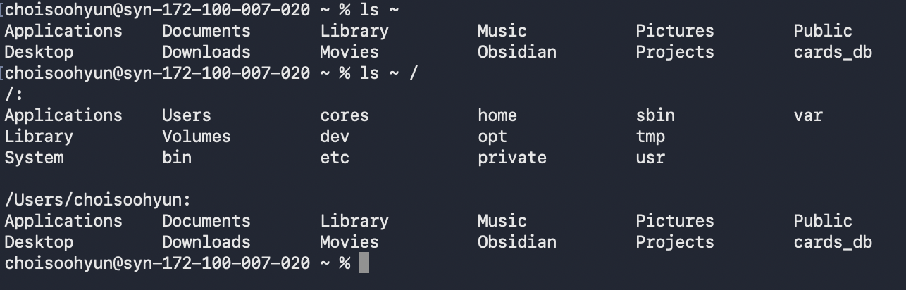

## More Fun With **ls** 
### ls 명령어의 정의 
- List directory contents 

**사용법** 
```zsh 
% ls ~/usr 
% ls ~ /usr 
*/이 둘의 결과는 다릅니다. 위의 결과는 홈디렉터리 안 usr폴더를 보는 것이며 아래 ~(tilde)+ /usr의 리스트를 각각 따로 보는 것을 의미합니다.*/ 
```


### 더 많은 디테일을 원한다면? 
- 명령어 **-l**사용 가능합니다. 
- **사용법** 
```zsh 
% ls -l 
# long format으로 아웃풋 변경 가능합니다. 
```

## Options and Arguments 
- 여러 옵션들을 통해 command의 행동들을 통제 가능합니다. 
- 기본형 
` % command -options arguments` 
-  **example** 
```zsh 
% ls -lt
```

- -l: Display results in long format. 
- -t : Sort by modification time . 


## A Longer Look at Long Format 
- the option *-l* 
	- cause *ls* command to display its results in long format.
- 디렉터리의 접근권한(Directory Permissions)
	- 정의: 디렉터리는 파일 이름과 해당 파일을 가리키는 정보를 관리하는 특수 파일이다. 따라서 일반 파일과 디렉터리에서는 접근 권한의 의미가 다르다. 
	- 타입: 
		- *r(read)* 
			- 일반 파일: 파일 내용 읽기 
			- 디렉터리: 내부 항목의 이름 목록 읽기 
		- *w(write)*
			- 일반 파일: 파일 내용 수정 
			- 디렉터리: 내부 항목 생성, 삭제 ,변경 
		- *x(Execute)*
			- 일반파일: 파일 실행 
			- 디렉터리: 내부 경로 탐색 및 접근 
- 예제로 살펴보기 
```zsh 
drwx------@ 5 soo staff 160 Feb ... 

```
- d: 디렉터리 
- rwx: 소유자에게 읽기·쓰기 ·탐색 권한 부여 
- ---: 소유 그룹에 권한 없음 
- ---: 기타 사용자에게 권한 없음 
- @: macOS 확장 속성 존재 

## Determining a File's Type with file 

